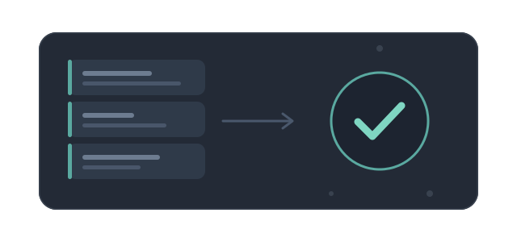

# dsh-plugin-creator



给 [DeepSeek Harness](https://github.com/deepseek-ai)（DSH）用的**插件开发增强包**：把「写一个 DSH 插件」从临时摸索变成一条有工具兜底的流水线。

装上它只扩展**创造模式**（`cordis` 预设），标准、PTC、极简、数据分析会话看不到任何新增；卸载时把它加的东西全部带走。

```powershell
# 先装进沙盒，确认无误再装进你工作的 profile（本地安装默认被守卫拦下）
plugin_manager  action: install_bundle  target: <这个检出的路径>
```

## 目录

- [这是什么](#这是什么)
- [它给你什么](#它给你什么)
- [快速开始](#快速开始)
- [方案：模板 + 配置 + 命令](#方案模板--配置--命令)
- [为什么分层](#为什么分层)
- [沙盒](#沙盒)
- [只在创造模式：实现与代价](#只在创造模式实现与代价)
- [目录结构](#目录结构)
- [验证](#验证)
- [开发](#开发)
- [路线图](#路线图)

## 这是什么

一个插件的生命周期是 **构思 → 项目启动 → 规范化开发与检查 → 功能测试 → 集成测试 → 发版**。这个包让其中**机械的部分**稳定、快，把**判断**留给 skill 和对话。

**现状，说清楚**：项目启动、规范化检查、功能测试、客户端 UI 检查、发版检查都已成形；**构思**（把需求变成一个插件形态）还只是对话。这份差距清单是刻意的，它就是路线图。

**第一条设计原则**：创造模式自带的工具是这个插件的地基。加东西之前先看这个预设已经装了什么（`dsh --profile <p> --dump-config`、`cordis_inspect_*`），而不是重新实现一遍。安装与启用是 `plugin_manager` 的事；运行时的真相来自 Inspect，不是读源码；凡是判断，都属于 skill。

完整论述——六段能力表及缺口、32 个出厂插件按「对本设计意味着什么」分组、四条设计原则——见 [docs/PHILOSOPHY.md](docs/PHILOSOPHY.md)。

## 它给你什么

讲能力，不讲功能清单。哪个工具实现哪条能力、参数与边界，在 [docs/TOOLS.md](docs/TOOLS.md)。

**把模糊需求变成一个插件形态** —— 「我想让团队协作好一点」这种话直接生成，产出的包一定返工。所以先构思：用 `scenario-driven-product-design`（宿主有的话）做场景分析，再按一张**形态判定表**落到 DSH 的扩展点上——工具、客户端半边、预设、预设级挂载、skill、还是配置——最后产出五行决策记录（目标用户、核心场景、边界、形态与理由、第一版做哪个）。这五行直接变成生成器的输入。清单在 `skills/dsh-plugin-new/references/conception.md`，不依赖外部技能也能走完。

**起一个插件** —— 一次调用产出清单、bundle patch、入口模块、多语言字典、图标、README，按需带示例工具与 skill。确定性：同样输入永远同样产出。返回前先自检，所以结构报告和插件同一轮到齐。

**知道它为什么装不上、显示不出来** —— 只读结构检查把问题一次报完，而不是遇到第一个就抛：清单字段、声明的 patch、locale 与图标导出、入口模块、详情文档、打包白名单。每项 pass / warn / fail。

**交付一个不夹带私人信息、并且敢说自己能干什么的包** —— 同一个检查会找作者自己的账号路径与凭据形态（私钥、API token、家目录），发现即 fail；示例里的占位账号保持安静。它拒绝安装期钩子和动态代码求值，并打印**能力清单**：哪些文件跑命令、开连接、写文件、读环境。

> 最后这条是报告不是判决：「不会搞坏任何东西」无法静态证明，但「能做什么」可以列出来，审阅的人应该看得到。

**把项目自己的边界写成规则** —— 项目根的 `checks.json` 声明什么必须一直成立：相对文档链接可解析、多语言 key 一致、分层源码不向外 import、内层不碰宿主模块、不该打日志的地方没有 console。逐条报告，每句都能照着改。**边界属于项目，不属于工具。** 见 [docs/CHECKS.md](docs/CHECKS.md)。

**让开发中的插件进不了你在用的环境** —— 本地目录安装被拒绝，只有三种例外：已发布版本、本身是沙盒的宿主、用户明确决定。风险不对称：沙盒里一个坏 patch 的代价是一次重启，同样的 patch 落在工作 profile 上，代价是一个起不来的宿主。

**在沙盒里测插件，而不是在桌面端** —— 一个项目多个隔离实例（日常迭代、干净复现、UI 状态、回滚演练），各有自己的 home、profile、端口、工作区副本。复用而非重建，带标记所以不会被别的项目误接管，可以启动、按 HTTP 探活、灌真实数据、停掉，全程不碰你在跑的东西。

**看见页面，并对它断言** —— 无头浏览器经 DevTools 协议打沙盒：真实截图，对选择器、文案、表达式、console 报错断言，真实点击与输入——不是合成的 `element.click()`，React 输入框和 contenteditable 会忽略那种。截图证明渲染成什么样，断言证明什么必须成立，两者都不能代替人判断观感。见 [docs/UI.md](docs/UI.md)。

**从模板生成任何结构化内容** —— 插件脚手架只是通用能力的一个实例：**方案**是数据（变量、文件映射、条件、规则）加模板，所以新方案是一个目录，不是新生成器。见 [docs/SCHEMES.md](docs/SCHEMES.md)。

**发一个你已经装过一次的版** —— 就绪检查去问打包器**真实**会装进 tarball 的东西（不是 `files` 声称的），并拿 `engines.dsh` 和运行中的 DSH 比对，版本不匹配在安装前就被发现。演练随后打包、装进沙盒、把组合配置读回来，顺手给回滚命令。**发布仍是人的决定**：工具只报「能不能发、该跑什么」。见 [docs/RELEASE.md](docs/RELEASE.md)。

**判断放在该放的地方** —— 两个 skill 承载工具不该编码的东西：生成前该问什么，以及怎么测一个插件而不产出假证据。

## 快速开始

```powershell
# 1. 建一个沙盒（装的是本检出，不影响桌面端）
node scripts/sandbox.mjs create default --plugin .
node scripts/sandbox.mjs start default     # 打印带 token 的地址

# 2. 在页面里：Settings → Models 加一次模型，然后新开会话选「创造模式」
# 3. 跟 agent 说要一个插件，它会先访谈你

# 4. 发版前
node scripts/release.mjs check .
node scripts/release.mjs rehearse . --sandbox rollback
```

安装到真实 profile 时（想清楚了再执行）：

```powershell
dsh plugin --profile desktop add link:<这个检出>
```

本地目录安装是把检出链接进去，所以 `tools/`、`skills/` 的改动不用重装——但改过的模块仍需重启才能加载新的模块代际，skill 的改动由 skill 提供者实时拾取。

## 方案：模板 + 配置 + 命令

生成插件是一条通用能力的实例，所以就这么建。一个**方案**是一个目录：`recipe.json`（变量、文件映射、条件、规则）、模板（每个变体一个文件），以及只在需要计算时才有的 `derive` 钩子：

```
templates/bundle/
  recipe.json          变量、文件、when 条件、规则、警告
  *.tpl                每个变体一个文件；永远不当作代码求值
lib/generate.js        通用引擎：变量 → 文件 → 规则
lib/rules.js           声明式结构检查
lib/scaffold.js        bundle 方案：derive 钩子 + 深度 bundle 检查
```

引擎对「插件」一无所知——这正是「新方案是一个目录」的由来：描述变量、映射文件、声明不变量，已有入口原样驱动它。

三条性质**强制**而不是写在文档里，因为正是它们决定生成器可不可信：

| 性质 | 含义 |
|---|---|
| **选择，不是条件分支** | 一个变体就是一个模板文件，由 `when` 子句挑；选择逻辑集中在一处可见 |
| **未解析占位符是致命错误** | 剩下一个 `{{token}}` 意味着 recipe 与模板不一致；失败好过发出去半个文件 |
| **规则跑在产物上** | `placeholder-free`、`files-listed`、`json-field`、`frontmatter-name`；bundle 的规则已抓到过真 bug（`.gitignore`/`.gitattributes` 生成了却没标成本地文件） |

JSON 也由模板渲染，`{{name|json}}` 负责转义，于是「生成什么」只有一个真相来源。完整格式见 [docs/SCHEMES.md](docs/SCHEMES.md)。

## 为什么分层

填模板是确定性的字符串工作；访谈用户是判断。混在一起正是模板生成器不可靠的原因，所以每条能力都按同一个形状建：

| 层 | 职责 |
|---|---|
| **引擎**（`lib/`） | 纯粹、无依赖、可测，不知道插件是什么 |
| **方案**（`templates/`） | 把结构当数据：变量、文件映射、条件、规则 |
| **两个前台** | 面向 agent 的工具 + 面向人的 CLI，共用同一引擎，谁都不用重写 |
| **一个 skill** | 引擎不该编码的判断：问什么、定什么、什么算验证过 |

工具前台不是装饰：它让自动化在本仓库之外也成立（项目根来自会话，不来自本包），也让它不依赖 PATH（启动器从宿主可执行文件推导）。沙盒是同一个形状少一层——它不渲染文件，加模板层只是仪式。

**故意没做斜杠命令**（`/new-plugin`）：`commands.register` 存在、做起来也便宜，但命令只收到一行 `rawInput`，而这里的字段需要对话——命令要么强迫 `name=... title=...` 语法，要么只是注入一段提示，而后者跟直接跟 agent 说话没区别。

## 沙盒

测插件意味着跑一个**不是用户桌面端**的 `dsh web` 实例。这个包提供让这件事可重复的登记表：

```
<项目>/tmp/sandboxes/
  registry.json           name → home / workspace / profile / port
  default/
    sandbox.json          标记：这个文件夹属于哪个项目、哪个沙盒
    home/                 沙盒的 DSH_HOME
    workspace/            会话实际运行的工作区副本
    open.log              `open --run` 的输出；URL 从这里读
```

一个项目想放多少就放多少：`default` 日常迭代、`clean` 从零复现、`client` 看 UI 状态、`rollback` 演练回滚。全部**复用**，从不隐式重建——pnpm 安装、profile 里的插件版本、模型凭据都在沙盒 home 里。

放在项目自己的 `tmp/` 下，绝不在 `~/.dsh` 或系统临时目录，所以它跟着项目走、跟着项目消失。`sandbox.json` 是身份检查：`project` 必须是本项目的根，任何操作都拒绝标记不符的文件夹。端口在项目内唯一，所以两个停掉的沙盒不会抢同一个端口。页面上的工作区标题读作 `sandbox <项目>/<沙盒>`，用来区分多个运行中的沙盒。

三条行为来自一个插件 UI 项目上的真实事故：

| 教训 | 做法 |
|---|---|
| **端口不是身份** | 启动时记下真正监听的 pid，停止只杀那个 pid；占着端口的陌生进程被报告并放过。曾经「谁占端口杀谁」，把用户的桌面端一起杀了 |
| **契约检查带着 token** | 用沙盒从自己日志里解析的 token 请求路由，401/400/404/405 不用去 URL 里翻；返回内容里的 token 一律脱敏 |
| **灌数据胜过空 home** | 空 home 每个面板都是空状态，最有意思的渲染永远跑不到；可从真实 `~/.dsh` 只读复制具名条目。凭据也能复制，并且结果会说明——借来的凭据不算验证过的凭据 |

**模型凭据留在用户手里。** 沙盒启动时 `.credentials.yaml` 里只有一条浏览器会话记录，页面因此显示「请选择模型」、发不出消息。用户在 Settings → Models 加一次，它落在这个沙盒的 home 里，之后每次运行都复用——没有脚本去搬用户的凭据。登记表按记录名报告 `model: yes / no`，因为在这个 DSH 版本里该文件从不为空（无模型时也有约 160 字节骨架）。

命令与参数见 [docs/TOOLS.md](docs/TOOLS.md)。

## 只在创造模式：实现与代价

bundle patch（`cordis.patch.yml`）覆写出厂的 `preset-cordis` 行，并在插件列表末尾追加两行：

- `creator-tools` → `dsh-plugin-creator/tools`，在这个预设的上下文里注册工具；
- `creator-skills` → 第二个 `@deepseek-ai/dsh-skill-filesystem` 提供者，`includeDefaultRoots: false`，`customSkillDirs` 指向本包 `skills/`。

patch 还插入一行 Host 行 `creator-host`：它今天不注册任何东西，存在的意义是让这个 bundle 在 Plugin Manager 里有一个稳定的身份行。卸载会移除整个 patch 层，`preset-cordis` 回落到出厂声明，工具与 skill 一并消失。其他预设既没有被 patch，也没有被复述。

### 这个做法的代价

patch 会**整体替换**一行的 `config`——补丁从不深合并，而预设的 `plugins` 就在 `config` 里，DSH 也没有「往已有预设追加」的机制。所以覆写必须把出厂插件列表整段复述，标在 `# --- shipped preset-cordis ---` 与 `# --- end shipped ---` 之间。

两个后果：

1. **升级 DSH 后要重抄那一段**（当前复制自 DSH 0.2.2-rc.5）。新版若给创造模式加了一行，本 bundle 会把它盖住。
2. **用户在 Web UI 预设编辑器里改创造模式后**，编辑器会往 profile patch 写自己的一整份覆写，优先级高于本 bundle——工具与 skill 会消失，直到用户重新加回或删掉那份覆写。

## 目录结构

```
package.json          bundle 清单：exports、files、dsh.bundle.patch
cordis.patch.yml      patch 层：Host 行 + 创造模式预设覆写
index.js              Host 半边（今天不注册东西；将来放共享服务）
tools/index.js        预设作用域半边：工具与安装守卫
lib/bundle-check.js   结构检查器（隐私与安全两组也在里面）
lib/generate.js       通用模板引擎（recipe → 文件 → 规则）
lib/rules.js          声明式结构检查
lib/scaffold.js       bundle 方案（derive 钩子 + 深度检查）
lib/sandbox.js        沙盒引擎（工具与 CLI 共用）
lib/ui.js             CDP 客户端与无头浏览器（工具与 CLI 共用）
lib/checks.js         项目规则加载与执行
lib/release.js        发版就绪检查、打包、演练
templates/bundle/     bundle 方案：recipe.json + 每个变体一个模板
skills/               挂进创造模式的 skill
locale/{en,zh}.json   Plugin Manager 的标题 / 说明 / 详情路径
docs/                 设计文档 + 详情页
icon.svg              插件图标
scripts/              CLI 与回归检查
```

## 验证

1. `dsh --profile desktop --dump-config` 里能看到 `creator-host` 行，以及一个插件列表以 `creator-tools`、`creator-skills` 结尾的 `preset-cordis`。
2. **新开**一个创造模式会话，工具列表里有本包的工具，skill 列表里有 `dsh-plugin-new`、`dsh-plugin-sandbox`。
3. 新开一个标准模式会话，一个都没有。
4. 对本仓库跑 `node scripts/check-project.mjs .`，5 条规则全过。

已有会话保留它创建时的组合；预设是在会话创建时解析的。

## 开发

纯 ESM，**无依赖、无构建步骤**，这是刻意的：预设行从 profile 解析 import，所以 `@deepseek-ai/*` 那套编写辅助（`defineTool`、schemastery）在这里 import 不到，工具因此写成裸 JSON Schema。

不需要宿主就能跑的检查：

```powershell
node scripts/try-tool.mjs .        # 桩上下文上挂载全部工具 + 守卫
node scripts/try-sandbox.mjs       # 沙盒引擎，用假 dsh 启动器
node scripts/check-project.mjs .   # 项目自己声明的规则（断链、locale、契约漂移…）
node scripts/check-patch.mjs .     # 解析 patch 并与出厂预设比对
```

`try-tool.mjs` 是模板的回归测试：生成的 bundle 通不过自己的结构检查它就失败，所以一次破坏产物的模板改动不用安装任何东西就能被抓到。`try-sandbox.mjs` 用假启动器驱动 create / start / status / stop——不引导 profile、不占真实端口——覆盖归属标记、端口唯一、工作区改写、凭据扫描。

`check-patch.mjs` 用 DSH 同款 YAML 库解析 patch 并与 `@deepseek-ai/dsh-web-app/presets/cordis.patch.yml` 比对：漏行、行序变化、plan-mode 段落被改、意外新增，都会失败。桌面版里那个文件在 `app.asar` 内，所以要用 DSH 的运行时跑：

```powershell
$env:ELECTRON_RUN_AS_NODE = "1"
& $env:DSH_NODE_EXECUTABLE scripts\check-patch.mjs .
```

改动用隔离实例验证，别用桌面端（`dsh-plugin-isolated-test` skill 就是流程）：

```powershell
$env:DSH_HOME = "<这个检出>\tmp\iso-home"   # 复用，不要每次重建
dsh --profile iso-creator --host 127.0.0.1 --port 3099 --no-open
```

`tmp/` 已被 git 忽略。

## 路线图

按 [docs/PHILOSOPHY.md](docs/PHILOSOPHY.md) §1 的生命周期缺口排序。

| 阶段 | 已完成 | 待补 |
|---|---|---|
| **规范化检查** | 项目声明式规则（断链、locale 对齐、分层方向、console 卫生、契约漂移）；生成的包自带起手 `checks.json` | patch 的 YAML 语法、预设声明、skill frontmatter |
| **集成测试** | CDP 截图 / 断言 / 真实点击输入；创造模式多出工具与 skill 已在真实会话确认 | 通过 Inspect 断言 slot 注册与主题 token |
| **发版** | 按真实包面与 `engines.dsh` 的就绪检查；装 tarball 读回组合的沙盒演练 | 模板直接产出 `engines.dsh`，让不兼容在激活前被拒 |
| **构思** | 场景分析流程（`scenario-driven-product-design` 优先，缺失时用自带清单）+ 形态判定表 + 五行决策记录 | 仍是对话流程，没有机械校验；形态选错，后面全在为错误的形状服务 |

基础设施：

- `scripts/sync-preset.mjs` —— 从已安装的 DSH 重新生成出厂 `preset-cordis` 段落，而不是手工再抄一遍；
- 模板变体：带客户端半边的 bundle（slot 注册）、自带预设声明的纯预设 bundle；
- 可选的 `/new-plugin` 斜杠命令，前提是确认 `/` 菜单在目标宿主能渲染。

## 来源

`skills/dsh-plugin-sandbox/` 起初是本地 skill `~/.dsh/skills/dsh-plugin-isolated-test` 的副本，后来按沙盒模型改名并重构（一个项目多个沙盒、复用、把模型配置交给用户）。它的 `references/` 仍早于那次改名——里面写「隔离实例」或 `iso-home` 的地方，读作「沙盒」。`~/.dsh/skills/` 下的原件没有动。
